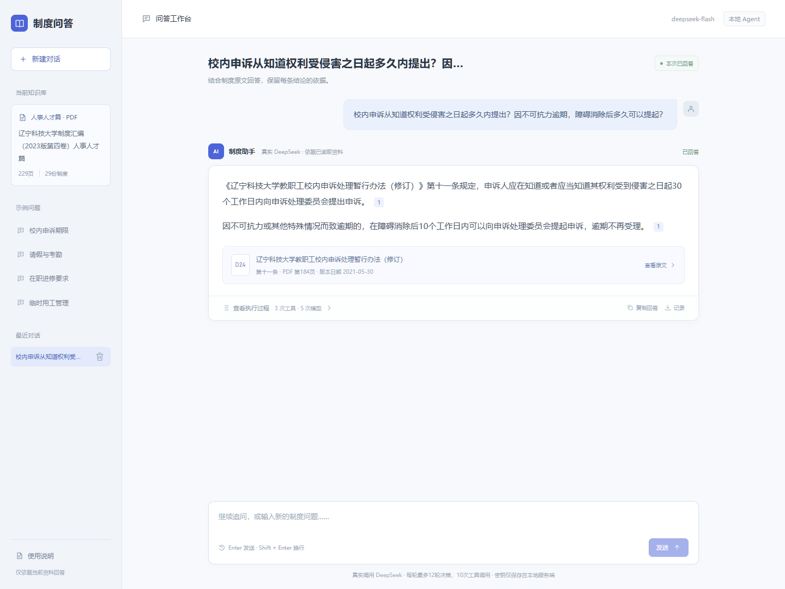
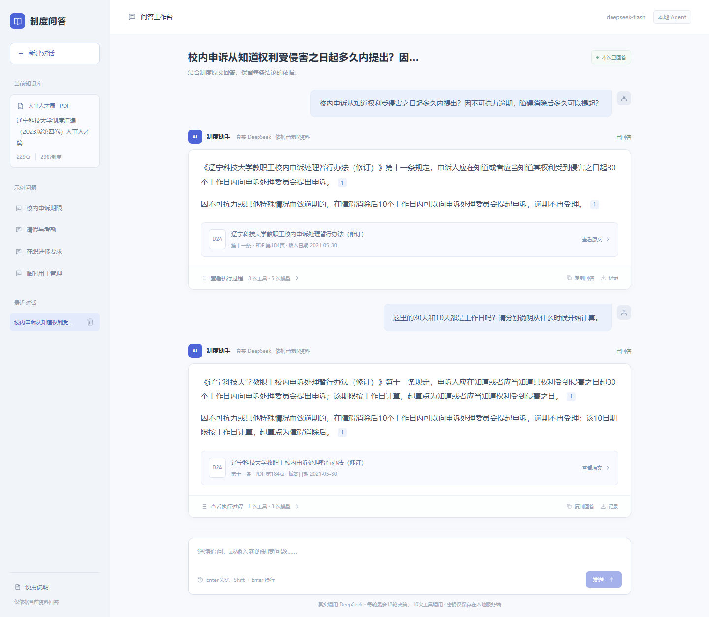
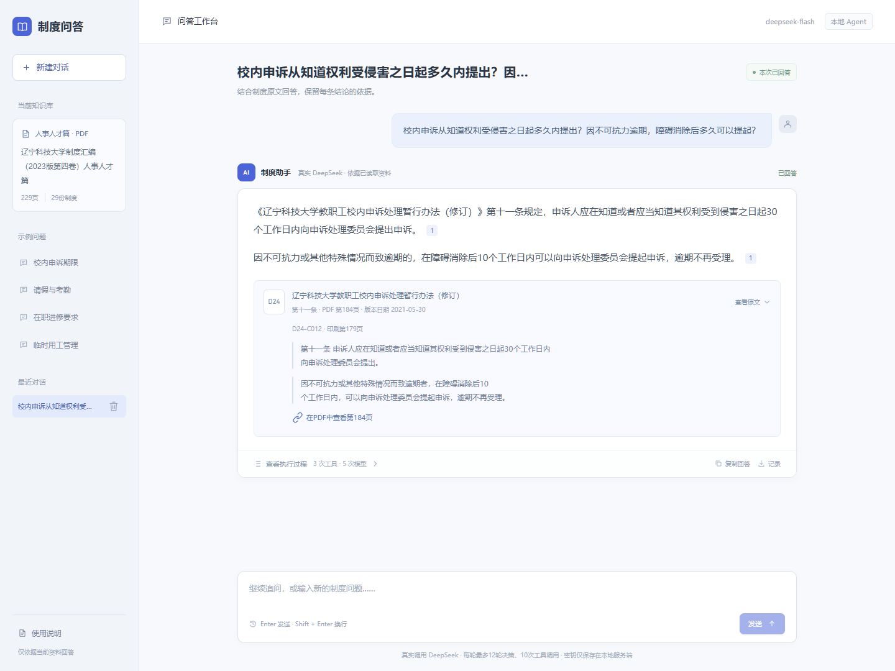
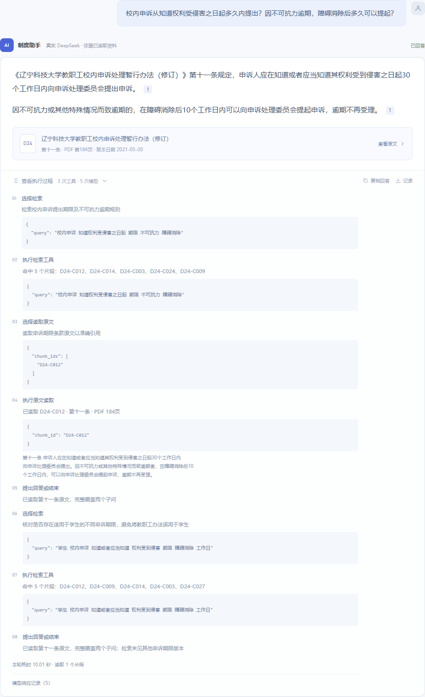
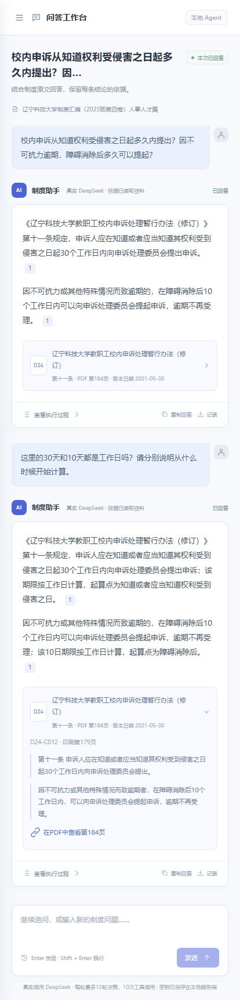
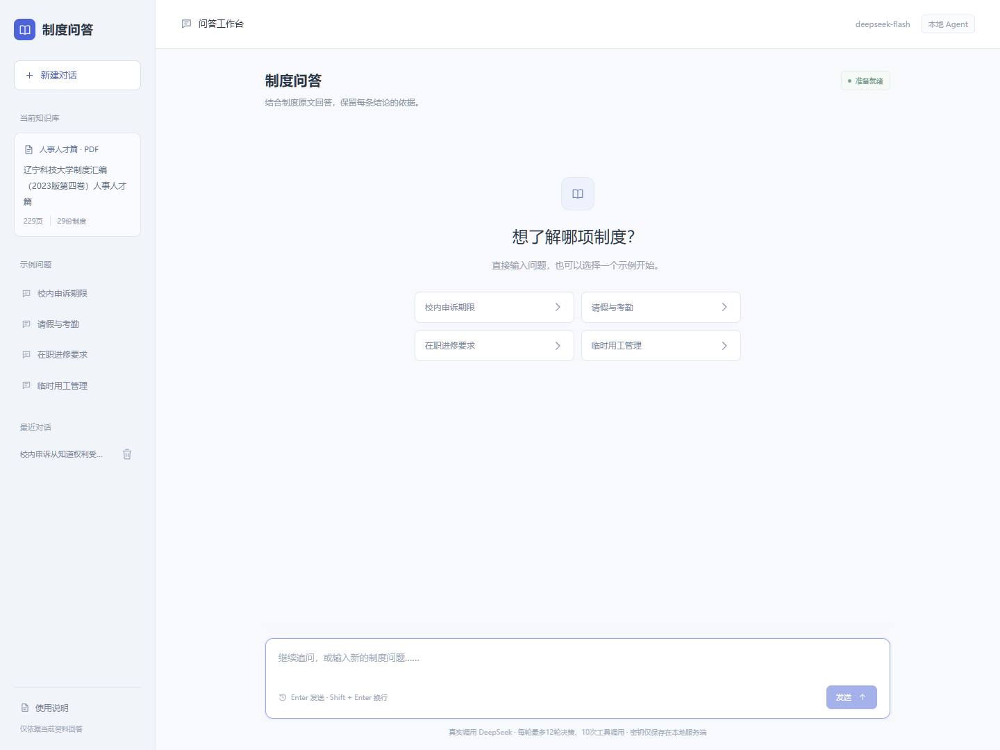

# 小影 AI 笔试第三题：企业知识问答 Agent

面向教职工的人事制度问答工具，提供CLI与Vue 3页面。使用用户指定的唯一 PDF，通过中文混合检索与真实 DeepSeek 决策，输出回答、文档 ID、原文引用、资料缺口和任务状态。

**评审入口：[交付与验收对照表](docs/SUBMISSION.md) → [最后一轮结果与真实一问一答](docs/LATEST-TEST-RESULTS.md) → [依据缺口与未完成案例说明](docs/FAILED-CASES.md)。**

当前按用户授权的“内容正确优先”口径：**Agent正确处理率100.00%**，**基础RAG正确处理率92.50%**，**关键场景稳定性正确处理率100.00%**。比例包含合理资料不足、追问及预期停止；基础RAG另有3组因测试注入故障后缺少恢复流程而未完成，不记回答错误。原答案不变，属于既有记录的事后重分类，规则与证据见[评分说明](docs/CONTENT-POLICY.md)。

## Vue 3 问答页面

支持多轮追问、原文引用展开、PDF定位、实际执行过程、复制回答与下载记录。直接复用现有真实DeepSeek Agent，浏览器不保存密钥。完整安装、开发模式、限额与故障处理见 **[Web使用说明](docs/WEB-UI.md)**。

完成下文Python安装、.env配置和build-index后，在仓库根目录执行：

~~~powershell
cd frontend
npm ci
npm run build
cd ..
.venv\Scripts\python -m policy_agent.webapp
~~~

打开 **http://127.0.0.1:8000**。Node.js需满足20.19+的20系列或22.12及以上，本次实测24.11.1。每个Web会话最多8轮，每轮独立使用12轮决策、10次工具预算；CLI批量会话仍按整组共享预算。页面过程在本轮完成后展开查看。

### 实际运行截图

以下6张均来自本次运行中的Vue页面。问答为真实DeepSeek输出，非样式占位内容；原始记录、调用用量与截图哈希见[Web验证材料](examples/submission/web-ui/README.md)。

**完整问答页面**

**多轮上下文追问**

**引用原文与PDF定位**

查看另外3张：执行过程、手机布局、新建对话页面

**真实执行过程（局部截图）**

**手机窄屏布局**

**新建对话页面**

## 安装与无需密钥的检查

推荐 Windows x64、Python 3.13（本次实际版本3.13.13）。代码声明Python 3.11+；其他平台未完成同等复现。需在仓库内使用可编辑安装，资料和提示词从仓库读取。首次安装需要联网下载依赖；首次真实检索需要下载嵌入模型。

~~~powershell
git clone https://github.com/xiao2wei/xiaoying-AI-test.git
cd xiaoying-AI-test
python -m venv .venv
.venv\Scripts\python -m pip install -c constraints-tested.txt -r requirements.txt
.venv\Scripts\python -m pip check
.venv\Scripts\python scripts/demo_offline.py --out work/local-offline-demo
# 完整程序测试含真实检索集成测试，须先下载嵌入模型并构建索引（不调用DeepSeek）
.venv\Scripts\python -m policy_agent.cli build-index
.venv\Scripts\python scripts/run_tests.py work/local-program-tests.json
~~~

demo_offline.py是明确标注的 **OFFLINE MOCK**：预设模型动作和检索候选，实际执行读取、引用校验与调用上限；不调用API，不下载嵌入模型，不用于证明真实模型效果。无密钥或模型服务不可用时可运行此入口。真实模式不会静默降级为Mock。

## 真实 DeepSeek 问答

~~~powershell
# 首次配置；已有.env请保留。把自己的Key填入.env，切勿提交。
Copy-Item .env.example .env
# data/processed已随仓库提供；从唯一PDF重建可另运行 scripts/prepare_corpus.py
.venv\Scripts\python -m policy_agent.cli build-index
.venv\Scripts\python -m policy_agent.cli ask "人才科研建设专项经费项目最长执行多久？" --mode agent --output work/answer.json
# 基础RAG对照：同一问题增加 --mode baseline
# 多轮会话：前一轮问答由程序传入下一轮，整组共享执行预算
.venv\Scripts\python -m policy_agent.cli batch --dataset examples/inputs/conversation.json --mode agent --out work/conversation
~~~

输出包含status、answer、claims（含doc_id、chunk_id、quote、版本日期和双页码）与gaps。记录文件还含工具参数、观察、下一步动作及简要依据；不保存模型内部推理正文。默认整组最多12轮决策、10次工具尝试；达到上限返回limit_reached及未完成原因。

当前默认回答模型deepseek-flash，独立评分模型deepseek-v4-pro；可在.env配置。模型调用会产生费用。动作通常关闭thinking，最终核对开启thinking且计入预算。模型别名和服务能力可能变化，实测请求/响应模型均保留在Trace。

## 复核已有结果，不产生 API 费用

~~~powershell
# 当前内容口径复算（输出目录必须尚不存在）
.venv\Scripts\python -m policy_agent.content_scoring --out work/content-policy-recomputed
# 以下为原严格指标的历史复算
.venv\Scripts\python -m policy_agent.metrics --dataset evaluation/formal.json --runs examples/step08/v4/agent-runs --scores examples/step08/v4/human-reviewed-r1/agent-scores --program examples/step07/program-tests-v17.json --stability examples/step08/v4/human-reviewed-r1/stability-observations.json --out work/recomputed-metrics
.venv\Scripts\python scripts/check_submission.py --out work/submission-check.json
~~~

metrics命令只复算数值；人工确认状态和用户接受差距的决定见[正式复核记录](examples/step08/v4/human-reviewed-r1/completion.json)，不由统计程序自动推断。

如确需新增真实批量实验，可运行以下命令；它们会消耗API，不是查看既有结果的必需步骤。使用全新目录以保留历史：

~~~powershell
.venv\Scripts\python -m policy_agent.cli batch --dataset evaluation/dev.json --mode agent --out work/new-agent
.venv\Scripts\python -m policy_agent.evaluation score --dataset evaluation/dev.json --runs work/new-agent --out work/new-scores
~~~

## 数据、结构与技术取舍

- [辽宁科技大学制度汇编（2023版第四卷）人事人才篇.pdf](data/source/辽宁科技大学制度汇编（2023版第四卷）人事人才篇.pdf)：唯一原始资料，229页。29份制度、562个片段、61张表格保留出处。使用真实制度汇编而非合成制度；合成的是测试问题与工具故障。某制度发布日期未知时保留null，不臆造日期。
- src/policy_agent/：原生Python Agent、模型接入、检索/读取、引用校验、独立评测。无Agent框架；框架名称不替代决策证据。
- frontend/：Vue3单页问答、浏览器交互测试、真实验证与截图脚本。
- tests/：确定性程序测试；不计入模型答题正确率。
- evaluation/：12组开发题、40组正式题、校准标签及人工确认。参考答案不进入检索索引或回答提示。
- examples/：真实输入、实际输出、Trace、评分、失败历史与交付复现记录。
- docs/01-requirements.md、02-solution.md、03-evaluation.md、04-ai-usage.md、05-retrospective.md：需求、方案、评估、AI使用与复盘；docs/steps/逐步记录。

检索使用BM25中文二元词与BAAI/bge-small-zh-v1.5本地向量，RRF融合，固定top5。原生循环便于检查动作、工具观察和退出边界。依赖及版本见pyproject.toml与constraints-tested.txt。

## 实测限制与实际用时

- 当前有Agent 2轮、稳定性2轮“回答正确但依据未给全”提示，未把补查证据伪装成原始模型引用。原严格评分的引用支持率99.04%、无依据事实率0.48%及3个关键缺陷场景标记保留为历史质量诊断；它们不等于新口径的内容错误数。
- 正式题库自早期版本起已用于返修，当前是已曝光题库的回归结果，不包装成未见测试。
- PDF只证明资料所载条文，不证明制度目前仍有效；不联网补充制度。数据提取的程序/AI检查不等于全文人工逐字校对。
- 项目主要实施日期为2026-10-30至2026-10-31。用户本人明确“未计时”；未虚构个人工时或声称3小时完成。可审计的问答用量和运行时间见examples/submission/time-record.json。
- 代码、资料处理和文档主要由Codex完成；用户负责选题、资料、范围、校准反馈与验收，详见AI使用记录。剩余改进不纳入本轮已接受范围。

原扣分场景的实际回答、原文位置与重新分类见[案例说明](docs/FAILED-CASES.md)。此前口径调整不新增DeepSeek请求；新增Web入口后83项程序测试、8项浏览器测试通过，2轮真实问答另产生8次模型请求，详见[Web验证](docs/steps/12-vue-web-ui.md)。[新规则](docs/CONTENT-POLICY.md)与旧分分别保留，不将口径变化宣称为模型能力提升。
